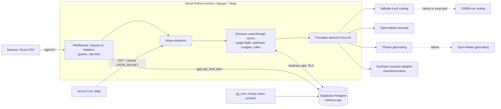

# Backend platform

The API is Django 5.2 with Django Ninja: stateless, cookie-free JSON under `/api/v1`, backed by
PostgreSQL (Supabase) through psycopg 3, and served on Vercel as one Python function
(`api/index.py`, a WSGI app). `shared/openapi.json` is the committed contract; the code is the
source of truth and CI fails when the snapshot drifts (`pnpm run openapi:export` regenerates it).

## Architecture



## Request pipeline

Outermost first (`MIDDLEWARE` in `haulcast.config.settings`). Every error, from any layer, leaves
as `application/problem+json` with a stable `code` and the request id; no stack trace is ever
returned (25 codes in `haulcast.problems`).

| Layer                                | What it does                                                                                                                                                                                                                                 |
| ------------------------------------ | -------------------------------------------------------------------------------------------------------------------------------------------------------------------------------------------------------------------------------------------- |
| `RequestContextMiddleware`           | Accepts or generates `X-Request-ID`, validates `Host` against `ALLOWED_HOSTS`, answers HEAD as GET, writes one structured JSON access-log line (latency, upstream timings, cache hit or miss; no IPs), sets the response headers and rewrites any non-problem error body |
| Django `SecurityMiddleware`          | `X-Content-Type-Options: nosniff`, `Referrer-Policy`                                                                                                                                                                                         |
| `RequestGuardMiddleware`             | Unsafe methods only: body above 16 KiB gives 413, a foreign `Origin` gives 403 `origin_not_allowed`, a non-JSON content type gives 400 `invalid_content_type`, checked in that order, before any work or database access                      |
| `RateLimitMiddleware`                | One decision per request, per client, with IETF `RateLimit-Policy` / `RateLimit` headers and `Retry-After` on 429                                                                                                                             |

Response headers: `Cache-Control: no-store` on errors and non-reads, `Cross-Origin-Resource-Policy:
same-origin` everywhere except `GET /api/v1/rules` and `GET /api/v1/openapi.json`, which are public
(`Access-Control-Allow-Origin: *`).

### Rate limits

Each policy is a GCRA bucket decided by one atomic SQL statement (`app.rate_limit_take`), so the
number of allowed calls is exact across threads and function instances. If the database is
unreachable the limiter falls back to an in-process bucket with the same policy: weaker, never
absent. The client key is `HMAC-SHA256(ip, RATE_LIMIT_SALT)`: raw addresses are neither stored nor
logged. Only one IP source is trusted (`CLIENT_IP_HEADER`, the header the platform overwrites); a
forwarded chain is ignored, never parsed. IPv6 clients are bucketed by their `/64`.

| Rule        | Applies to                         | Limit                |
| ----------- | ---------------------------------- | -------------------- |
| `plans`     | `POST /api/v1/plans`               | 6 per minute, 60 per day |
| `heatmap`   | `GET /api/v1/plans/{id}/heatmap`   | 30 per minute        |
| `geocode`   | `GET /api/v1/geocode`              | 60 per minute        |
| `liveness`  | `GET /api/v1/health` (in-process only, never touches the database) | 120 per minute |
| `default`   | everything else                    | 120 per minute       |

## Endpoints

| Operation                                        | Purpose                                                                                       |
| ------------------------------------------------ | --------------------------------------------------------------------------------------------- |
| `GET /api/v1/health` (`getHealth`)               | Liveness: version and commit; never touches the database                                      |
| `GET /api/v1/health/ready` (`getReadiness`)      | Readiness: one `SELECT 1` as the runtime role; 503 `database_unavailable` with `Retry-After`  |
| `GET /api/v1/geocode` (`geocode`)                | Place search, US-biased, normalised query, cached for 30 days                                 |
| `GET /api/v1/rules` (`getRules`)                 | The risk rules (`shared/risk-rules.json`) with an `ETag`; public CORS                         |
| `GET /api/v1/scenarios` (`listScenarios`)        | The demo scenario catalogue                                                                   |
| `GET\|POST /api/v1/internal/maintenance`         | Cron-only cleanup behind a Bearer `CRON_SECRET` (`runScheduledMaintenance`, `runMaintenance`) |
| `GET /api/v1/openapi.json`, `GET /api/v1/docs`   | The OpenAPI document and its docs UI                                                          |

The maintenance endpoint answers 404 until `CRON_SECRET` is configured and 401, without detail,
to any other caller; the secret is compared with `hmac.compare_digest`. Vercel Cron only issues
`GET`, so both methods exist. The plan and heatmap endpoints belong to the plan services.

## Providers

Each sits behind a Protocol and a shared httpx client: connect timeout 3 s, read timeout 8 s, two
full-jitter retries on idempotent calls, one retry on a 429 that honours `Retry-After`, and the
policy-compliant `User-Agent` `Haulcast/<version> (+repository URL)`. A health-aware chain decides
the fallback.

| Capability | Primary                                        | Fallback                         | Notes                                                                                                                                                              |
| ---------- | ---------------------------------------------- | -------------------------------- | ------------------------------------------------------------------------------------------------------------------------------------------------------------------ |
| Routing    | Valhalla, `costing=truck` (gross weight, top speed `TRUCK_TOP_SPEED_KPH`) | OSRM, car profile with a truck speed cap | Valhalla for trips up to 1,450 km great-circle; OSRM beyond that or when Valhalla fails. All routes of a plan come from one provider. Three distinct routes are forced with at most 6 extra calls inside 15 s |
| Weather    | Open-Meteo, hourly, 0.1 degree lattice          | none                             | Table cache (60 min), single-flight, global upstream budget of 500 per minute, 4,500 per hour and 9,000 per day (503 `weather_capacity_exhausted` beyond it)           |
| Geocoding  | Photon                                          | Open-Meteo geocoding             | NFKC-normalised query, US bias, 30-day cache                                                                                                                       |
| Scenarios  | `shared/scenarios/*.json` (validated by `scenario.schema.json`) | none      | Deterministic synthetic weather placed relative to the trip's fastest route: `calm`, `storm-on-fastest`, `high-wind-corridor`, `gulf-downpour`                      |

## Database

One schema, `app`. Django's unqualified table names land in it because both roles carry
`search_path = app`, so there are no quoted `db_table` tricks.

### Role model

| Role               | Used for                                          | Privileges                                                                                                                         |
| ------------------ | ------------------------------------------------- | ---------------------------------------------------------------------------------------------------------------------------------- |
| Administrator      | `backend/scripts/bootstrap_db.py`, once per database | The Supabase `postgres.<ref>` user (locally the cluster superuser). Creates the two roles below; never used at runtime              |
| `haulcast_owner`   | Django migrations (`migrate --database=owner`)    | Owns schema `app` (DDL). Login only: no superuser, create-db, create-role, replication or BYPASSRLS. Not forced through RLS         |
| `haulcast_app`     | The runtime, through the transaction pooler       | DML on the tables by default privileges, `EXECUTE` on the functions, nothing else; RLS applies. Cannot touch `django_migrations`    |

Nothing in `app` is reachable by `PUBLIC` or by Supabase's `anon`, `authenticated` and
`service_role`. Passwords are sent as SCRAM-SHA-256 verifiers computed client-side, so no plaintext
reaches a server log, and the script ends by verifying the resulting privilege matrix and rolling
everything back if it is off. It prints role names and a verdict, never a DSN or a password.

### Connections

| Purpose              | Supabase                                                   | Local                          |
| -------------------- | ---------------------------------------------------------- | ------------------------------ |
| Bootstrap, migrations | Session pooler, port 5432, user `postgres.<ref>` (bootstrap) and `haulcast_owner.<ref>` (migrations), `sslmode=require` | `TEST_DATABASE_URL` superuser |
| Runtime              | Transaction pooler, port 6543, user `haulcast_app.<ref>`, `sslmode=require`, `CONN_MAX_AGE=0`, no server-side cursors, `prepare_threshold=None` | the same role on the dev server |

The free Supabase plan's direct host is IPv6-only, so migrations use the session pooler.

### Tables

| Table               | Lookup key                                              | TTL         | Indexes beyond the primary key                                          |
| ------------------- | ------------------------------------------------------- | ----------- | ----------------------------------------------------------------------- |
| `geocode_cache`     | `key` (unique)                                          | 30 days     | `geocode_cache_expires_idx` on `expires_at`                             |
| `route_cache`       | `key` (unique)                                          | 24 hours    | `route_cache_expires_idx`                                               |
| `weather_cache`     | `weather_cache_lookup_uniq`: location, model, variable set, window start | 60 minutes | `weather_cache_expires_idx`                                |
| `plan`              | `id` (`pln_` + ULID)                                    | 7 days      | `plan_request_hash_idx` on (`request_hash`, `created_at`), `plan_expires_idx` |
| `rate_limit_bucket` | `key` (HMAC of the client, never the IP)                | minutes     | `rate_limit_bucket_expires_idx`                                         |
| `upstream_budget`   | `key`                                                   | minutes     | `upstream_budget_expires_idx`                                           |

Every table has row level security enabled with one policy, `haulcast_app_all`, for the runtime
role: Supabase's automatic RLS only covers `public`, so this is defence in depth next to the
schema-level revokes. SQL functions (all `SECURITY INVOKER`): `app.rate_limit_take`,
`app.upstream_budget_take` (one `INSERT ... ON CONFLICT DO UPDATE ... RETURNING` each) and
`app.cleanup_expired`. Expired rows are removed by the daily Vercel Cron call to the maintenance
endpoint, which doubles as the keep-alive that stops a free Supabase project from pausing, and by
an hourly `pg_cron` job when the extension exists (the migration is a no-op without it).

### Runbook

Variable names are listed in `.env.example`; never paste values into a terminal log.

```bash
# One command: bootstrap the roles, then migrate as haulcast_owner. Safe to re-run.
# Needs DATABASE_URL (administrator DSN, session pooler), HAULCAST_OWNER_DB_PASSWORD and
# HAULCAST_APP_DB_PASSWORD in the environment.
bash scripts/migrate-database.sh

# The same, step by step (from backend/):
uv run python scripts/bootstrap_db.py
uv run python manage.py migrate --noinput --database=owner

# Prove the runtime role works through the transaction pooler (DATABASE_URL_POOLED and
# HAULCAST_APP_DB_PASSWORD set): GET /api/v1/health/ready answers 200 with status and database "ok".
```

Deployed environments (`VERCEL_ENV` production or preview, or `HAULCAST_ENV=production`) refuse to
start unless `DJANGO_SECRET_KEY` (50+ characters), `ALLOWED_HOSTS`, `RATE_LIMIT_SALT` (16+),
`DATABASE_URL_POOLED` (or `DATABASE_URL`) and `HAULCAST_APP_DB_PASSWORD` are set, and `DEBUG` is
off. The error names the missing variables, never their values.

On Vercel (`VERCEL=1`) the hosts the platform assigned to the deployment (`VERCEL_URL`,
`VERCEL_BRANCH_URL`, `VERCEL_PROJECT_PRODUCTION_URL`) are allowed in addition to `ALLOWED_HOSTS`.
A preview host such as `<project>-<hash>-<scope>.vercel.app` is a single DNS label that changes with
every deployment, and Django's host patterns (exact name, leading-dot domain, `*`) cannot list it,
so without this every preview answered `400 Invalid Host header`. The variables must hold a bare
lower-case host name; anything else (scheme, port, path, wildcard) stops the start. Keep the stable
production domains and any custom domain in `ALLOWED_HOSTS`.

## Security notes

- No secret in the repository, logs or error bodies; configuration is read from the environment and
  malformed values raise instead of silently flipping a switch.
- Least privilege in depth: separate owner and runtime roles, RLS on every table, revokes from
  `PUBLIC` and the Supabase API roles, the runtime role cannot read migration history.
- Outbound calls go only to the fixed provider hosts; no user-supplied URL is ever fetched, and a
  geocoded label is returned as data, never interpreted.
- The API accepts JSON only (no uploads), caps bodies at 16 KiB and rejects cross-origin writes.
- Rate limiting never stores or logs an IP; spoofed forwarded chains are ignored.
- Constant-time comparison for the cron secret; the maintenance endpoint is invisible without it.
