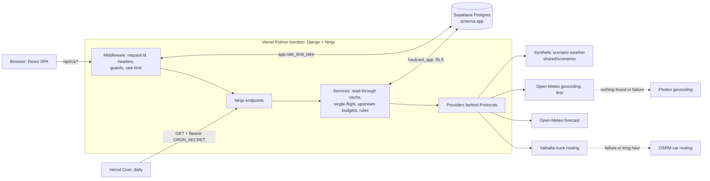

# Backend platform

The API is Django 5.2 with Django Ninja: stateless, cookie-free JSON under `/api/v1`, backed by
PostgreSQL (Supabase) through psycopg 3, and served on Vercel as one Python function
(`api/index.py`, a WSGI app). `shared/openapi.json` is the committed contract; the code is the
source of truth and CI fails when the snapshot drifts (`pnpm run openapi:export` regenerates it).

## Architecture



## Request pipeline

Outermost first (`MIDDLEWARE` in `haulcast.config.settings`). Every error, from any layer, leaves
as `application/problem+json` with a stable `code` and the request id; no stack trace is ever
returned (25 codes in `haulcast.problems`).

| Layer                                | What it does                                                                                                                                                                                                                                 |
| ------------------------------------ | -------------------------------------------------------------------------------------------------------------------------------------------------------------------------------------------------------------------------------------------- |
| `RequestContextMiddleware`           | Accepts or generates `X-Request-ID`, validates `Host` against `ALLOWED_HOSTS`, answers HEAD as GET, writes one structured JSON access-log line (latency, upstream timings, cache hit or miss; no IPs), sets the response headers and rewrites any non-problem error body |
| Django `SecurityMiddleware`          | `X-Content-Type-Options: nosniff`, `Referrer-Policy`                                                                                                                                                                                         |
| `RequestGuardMiddleware`             | Unsafe methods only: body above 16 KiB gives 413, a foreign `Origin` gives 403 `origin_not_allowed`, a non-JSON content type gives 400 `invalid_content_type`, checked in that order, before any work or database access                      |
| `RateLimitMiddleware`                | One decision per request, per client, with IETF `RateLimit-Policy` / `RateLimit` headers and `Retry-After` on 429                                                                                                                             |

Response headers: `Cache-Control: no-store` on errors and non-reads, `Cross-Origin-Resource-Policy:
same-origin` everywhere except `GET /api/v1/rules` and `GET /api/v1/openapi.json`, which are public
(`Access-Control-Allow-Origin: *`).

### Rate limits

Each policy is a GCRA bucket decided by one atomic SQL statement (`app.rate_limit_take`), so the
number of allowed calls is exact across threads and function instances. If the database is
unreachable the limiter falls back to an in-process bucket with the same policy: weaker, never
absent. The client key is `HMAC-SHA256(ip, RATE_LIMIT_SALT)`: raw addresses are neither stored nor
logged. Behind the platform only the header named by `CLIENT_IP_HEADER` identifies the client
(`x-forwarded-for` on Vercel, which overwrites it "to prevent IP spoofing";
<https://vercel.com/docs/headers/request-headers>). A value that is not exactly one IP (a chain) is
ignored, never parsed, and a request without a usable value shares one `unknown` bucket; the process
says so in one WARNING a minute (`client_ip_unavailable`: the header's name, never the value the
client sent), because a platform that stopped sending the header would otherwise throttle every
visitor together with no other sign. The socket
address (`REMOTE_ADDR`) is never a fallback for that header: Vercel's Python runtime fills it from
`x-forwarded-for`, else `x-real-ip` (vercel-runtime 0.23.3, `vc_init.py:1176-1178`), so it can name
a header the deployment did not choose. Without `CLIENT_IP_HEADER` (local development, tests) the
socket address is used. Behind a proxy of your own in front of Vercel, set
`CLIENT_IP_HEADER=x-vercel-forwarded-for`: Vercel documents it as identical to `x-forwarded-for` but
not overwritten by such a proxy. IPv6 clients are bucketed by their `/64`. A response that a shared
cache may store (`Cache-Control` with `public`, `s-maxage` or `max-age`, unless `no-store` or
`private` is also there; Vercel's CDN stores a function response on `max-age` alone,
<https://vercel.com/docs/headers/cache-control-headers>) carries `RateLimit-Policy` but neither
`RateLimit` nor `X-Request-ID`: the CDN would replay one client's remaining quota, and a request id
the client chose, to every other client (R2-31). Such a response has no id for the client to quote;
the access log still records the id of every request, so it can be found there by time and path.

| Rule        | Applies to                         | Limit                |
| ----------- | ---------------------------------- | -------------------- |
| `plans`     | `POST /api/v1/plans`               | 6 per minute, 60 per day |
| `heatmap`   | `GET /api/v1/plans/{id}/heatmap`   | 30 per minute        |
| `geocode`   | `GET /api/v1/geocode`              | 60 per minute        |
| `liveness`  | `GET /api/v1/health` (in-process only, never touches the database) | 120 per minute |
| `default`   | everything else                    | 120 per minute       |

## Endpoints

| Operation                                        | Purpose                                                                                       |
| ------------------------------------------------ | --------------------------------------------------------------------------------------------- |
| `GET /api/v1/health` (`getHealth`)               | Liveness: version and commit; never touches the database                                      |
| `GET /api/v1/health/ready` (`getReadiness`)      | Readiness: one `SELECT 1` as the runtime role; 503 `database_unavailable` with `Retry-After`  |
| `GET /api/v1/geocode` (`geocode`)                | Place search, US-biased, normalised query, cached for 30 days                                 |
| `GET /api/v1/rules` (`getRules`)                 | The risk rules (`shared/risk-rules.json`) with an `ETag`; public CORS                         |
| `GET /api/v1/scenarios` (`listScenarios`)        | The demo scenario catalogue                                                                   |
| `GET\|POST /api/v1/internal/maintenance`         | Cron-only cleanup behind a Bearer `CRON_SECRET` (`runScheduledMaintenance`, `runMaintenance`) |
| `GET /api/v1/openapi.json`, `GET /api/v1/docs`   | The OpenAPI document and its docs UI                                                          |

The maintenance endpoint answers 404 until `CRON_SECRET` is configured and 401, without detail,
to any other caller; the secret is compared with `hmac.compare_digest`. Vercel Cron only issues
`GET`, so both methods exist. Every 401 carries `WWW-Authenticate: Bearer`, as RFC 9110 requires.
The plan and heatmap endpoints belong to the plan services.

`GET /api/v1/docs` shows Swagger UI from the files that ship with Django Ninja, served by the API
itself under `/api/v1/docs-assets/ninja/` (the project's `STATIC_URL`; an allow-list of the five
files the page names, `haulcast/api/docs.py`): the page loads nothing from a third party.

### The miles of a plan

Every mile figure of a plan document is rounded for display on its own: `distance_mi` of a route
and of a checkpoint to 0.1, `owned_mi` of a checkpoint and the `cumulative_mi` points to 0.01,
`stats.miles_by_level` and `unknown_mi` to 0.1 (the precision the ranking compares at). Before
rounding the parts add up to the whole exactly: the checkpoints own the whole route, so the sum of
`owned_mi` is the route length (property-tested in the domain). After rounding they add up to it
only within the rounding: the sum of `owned_mi` differs from the route's `distance_mi` by at most
0.05 + 0.005 per checkpoint, and `miles_by_level` plus `unknown_mi` by at most 0.05 + 0.05 per
figure (T9 F-m8; pinned on a 317.37 mile route, which shows as 317.4 while its checkpoints own
317.37). The parts are deliberately not adjusted to force the sums: the ranking compares the same
rounded `miles_by_level`, so the document shows what the routes were ranked on.

## Providers

Each sits behind a Protocol and a shared httpx client: connect timeout 3 s, read timeout 8 s, two
full-jitter retries on idempotent calls, one retry on a 429 that names a short `Retry-After`, and the
policy-compliant `User-Agent` `Haulcast/<version> (+repository URL)`. Time is bounded as a whole, not
per phase: a request-scoped deadline (`providers/deadline.py`) cuts every attempt to what is left,
including the time its body takes to arrive, and no retry or sleep may cross its end (see "Time
budgets"). A client can also run a hook before **every** attempt, retries included: routing uses it
to keep one second between calls and to spend the shared budget, Open-Meteo to spend its budget. A
health-aware chain decides the fallback; each failover and each provider skipped for its cooldown is
logged as a `provider_failover` or `provider_circuit_open` event (provider names and the failure
class only, never a query or a coordinate). A rejected request (HTTP 4xx), an exhausted deadline and
a refused local budget say nothing about a provider and never open its circuit.

Routes are distinct when less than 80% of a candidate's **length** lies within 250 m of every route
already kept. The share is by length, not by polyline vertices: a winding stretch is described by
many more vertices than a straight one, so counting them would let it dominate (review R2-20; the
research defines the rule as the share of the route's length). One recorded case sits on the
threshold: the third Chicago to Denver route shares 80.2% of its length with the second kept route
(79.8% by vertex count), so that trip now returns two routes and says so.

| Capability | Primary                                        | Fallback                         | Notes                                                                                                                                                              |
| ---------- | ---------------------------------------------- | -------------------------------- | ------------------------------------------------------------------------------------------------------------------------------------------------------------------ |
| Routing    | Valhalla, `costing=truck` (gross weight, top speed `TRUCK_TOP_SPEED_KPH`) | OSRM, car profile with a truck speed cap | Valhalla for trips up to 1,450 km great-circle; OSRM beyond that, or when Valhalla times out, answers 5xx or 429, or refuses the trip (error 154). A truck's "no route" is final (422 `no_route_found`) and is never answered with a car route (D-17); OSRM's own `NoRoute` is an HTTP 400 and counts as no route too. All routes of a plan come from one provider, at most three: forced diversity adds at most 3 extra calls inside a 10 s stage (D-17), so a trip that needs more returns fewer routes and says so. Every attempt keeps one second between calls and spends the shared routing budget of 40 per minute |
| Weather    | Open-Meteo, hourly, 0.1 degree lattice | none | Table cache (60 min), single-flight, global upstream budget of 500 per minute, 4,500 per hour and 9,000 per day spent per attempt (503 `weather_capacity_exhausted` beyond it). A fill is fetched in batches of 250 locations and every batch is stored as it arrives, so a later failure does not throw the earlier ones away |
| Geocoding  | Open-Meteo geocoding (US cities) | Photon (street level, worldwide) | Open-Meteo first: T14 measured Photon at 6.7 s for an uncached query from iad1 and Open-Meteo at 1.0 to 1.4 s. "Nothing found" from the city index goes on to Photon, so the US restriction of that index is not a restriction of what can be found. One attempt of at most 2 s per provider and 3.5 s for the whole search; NFKC key, NFC labels, 30-day cache (1 hour for "nothing found"; when the street-level index could not be asked, "nothing found" is no verdict: it is stored nowhere and sent `no-store`) |
| Scenarios  | `shared/scenarios/*.json` (validated by `scenario.schema.json`) | none      | Deterministic synthetic weather placed relative to the trip's fastest route: `calm`, `storm-on-fastest`, `high-wind-corridor`, `gulf-downpour`                      |

## Database

One schema, `app`. Django's unqualified table names land in it because both roles carry
`search_path = app`, so there are no quoted `db_table` tricks.

### Role model

| Role               | Used for                                          | Privileges                                                                                                                         |
| ------------------ | ------------------------------------------------- | ---------------------------------------------------------------------------------------------------------------------------------- |
| Administrator      | `backend/scripts/bootstrap_db.py`, once per database | The Supabase `postgres.<ref>` user (locally the cluster superuser). Creates the two roles below; never used at runtime              |
| `haulcast_owner`   | Django migrations (`migrate --database=owner`)    | Owns schema `app` (DDL). Login only: no superuser, create-db, create-role, replication or BYPASSRLS. Not forced through RLS         |
| `haulcast_app`     | The runtime, through the transaction pooler       | DML on the tables by default privileges, `EXECUTE` on the functions, nothing else; RLS applies. Cannot touch `django_migrations`    |

Nothing in `app` is reachable by `PUBLIC` or by Supabase's `anon`, `authenticated` and
`service_role`. Passwords are sent as SCRAM-SHA-256 verifiers computed client-side, so no plaintext
reaches a server log, and the script ends by verifying the resulting privilege matrix and rolling
everything back if it is off. It prints role names and a verdict, never a DSN or a password.

### Connections

| Purpose              | Supabase                                                   | Local                          |
| -------------------- | ---------------------------------------------------------- | ------------------------------ |
| Bootstrap, migrations | Session pooler, port 5432, user `postgres.<ref>` (bootstrap) and `haulcast_owner.<ref>` (migrations), `sslmode=require` | `TEST_DATABASE_URL` superuser |
| Runtime              | Transaction pooler, port 6543, user `haulcast_app.<ref>`, `sslmode=require`, `CONN_MAX_AGE=0`, no server-side cursors, `prepare_threshold=None` | the same role on the dev server |

The free Supabase plan's direct host is IPv6-only, so migrations use the session pooler.

### Tables

| Table               | Lookup key                                              | TTL         | Indexes beyond the primary key                                          |
| ------------------- | ------------------------------------------------------- | ----------- | ----------------------------------------------------------------------- |
| `geocode_cache`     | `key` (unique)                                          | 30 days     | `geocode_cache_expires_idx` on `expires_at`                             |
| `route_cache`       | `key` (unique)                                          | 24 hours    | `route_cache_expires_idx`                                               |
| `weather_cache`     | `weather_cache_lookup_uniq`: location, model, variable set, window start | 60 minutes | `weather_cache_expires_idx`                                |
| `plan`              | `id` (`pln_` + ULID)                                    | 7 days      | `plan_request_hash_idx` on (`request_hash`, `created_at`), `plan_expires_idx` |
| `rate_limit_bucket` | `key` (HMAC of the client, never the IP)                | minutes     | `rate_limit_bucket_expires_idx`                                         |
| `upstream_budget`   | `key`                                                   | minutes     | `upstream_budget_expires_idx`                                           |
| `single_flight_lease` | `key` (kind and a digest of what is coalesced)        | seconds     | `single_flight_lease_exp_idx`                                           |

Every table has row level security enabled with one policy, `haulcast_app_all`, for the runtime
role: Supabase's automatic RLS only covers `public`, so this is defence in depth next to the
schema-level revokes. SQL functions (all `SECURITY INVOKER`): `app.rate_limit_take`,
`app.upstream_budget_take` (one `INSERT ... ON CONFLICT DO UPDATE ... RETURNING` each) and
`app.cleanup_expired`. Expired rows are removed by one mechanism: the daily Vercel Cron call to the maintenance endpoint,
which doubles as the keep-alive that stops a free Supabase project from pausing.

### Cleanup and table growth (D-32)

The hourly `pg_cron` job of migration `0004` is retired; migration `0005` unschedules it where it
exists (guarded on schema `USAGE`, portable, D-10). It ran as another identity over a localhost
libpq connection, needed a grant chain the Supabase administrator may not hold, never cleaned
`cron.job_run_details`, and could not be switched on after the fact because applied migrations never
re-run. Growth between two daily runs stays small (review R2, 5.1c):

| Table               | Bound                                                                                                  |
| ------------------- | ------------------------------------------------------------------------------------------------------ |
| `weather_cache`     | New rows follow the day budget: at most 9,000 a day (a hard bound now that every budget window is exact). About 4.6 KB a row (8 series, up to about 57 hourly values, about 10 B each), so 25 to 50 MB of expired rows before the daily delete and twice that if one run is lost (Vercel does not retry a failed cron call): well inside the free plan's 500 MB |
| `rate_limit_bucket` | About 200 B a row, 10,000 distinct clients a day is about 10 MB; only address-rotating abuse grows it |
| `geocode_cache`     | 30 days, an hour for "nothing found"; one row per distinct query                                       |
| `single_flight_lease` | Deleted when the work ends, expires by itself after 30 s, swept by the daily cleanup                 |

Revisit if the database passes about 250 MB or `rate_limit_bucket` about 500,000 rows: then a
Dashboard-created Supabase Cron job owned by `postgres` that runs `SELECT * FROM app.cleanup_expired()`
(plus one for `cron.job_run_details`) is the next step.

### Upstream budgets (D-19)

`app.upstream_budget_take` is a GCRA token bucket per window. A bucket whose burst equals its rate
admits twice its rate in one window after a rest (the review's probe P14: 19 of "10 per 2 s" in
1.97 s, which for Open-Meteo is about 18,000 calls a day against 10,000). So every window splits its
limit: `burst = limit // 2` is spent at once and `rate = limit - burst` refills over the window,
`burst + rate == limit`, and **no window ever admits more than its limit**, at the price of a sustained
rate of half of it (the cache makes most calls free). Open-Meteo: 500 per minute, 4,500 per hour,
9,000 per day (about 83% of the free tier); routing: 40 per minute. A draw spans all windows of a
budget and is all-or-nothing. It is spent by the provider's HTTP client **before every attempt**,
retries included, because the upstream counts each one; it is one short transaction of its own, and
tokens are never refunded (an attempt that timed out may still have been counted).

### Single-flight: nothing is held across an upstream call

When many requests need the same expensive thing at once (a plan, a route, a forecast fill), one of
them computes it and the others use the result, coordinated by a row in `single_flight_lease`
(`services/single_flight.py`). Claiming it is one short autocommit statement and releasing it
another, so the work in between holds no transaction, no row lock, no advisory lock and no pooled
connection: behind Supavisor in transaction mode a held transaction is a held server connection,
and the free plan has very few. Different work never queues (leases are per key). Identical work
coalesces: callers in one process wait on the leader's in-flight record and receive its failure too,
so an outage costs one upstream attempt, not one per waiter; across instances a follower polls the
lease and then looks for the value the leader stored. A leader that dies frees the work when its
lease expires (30 s, on the database clock), and every wait is bounded by the request deadline. A
failure is deliberately not remembered after the leader's own flight: only successes are cached, so
the next request tries again (its upstream attempts are still bounded and budgeted).

### Migration notes

Applied migrations are never edited, so what a reader needs to know about them is written here.

- `0002_row_level_security`: its reverse does not restore the default grant on `django_migrations`
  that the forward revoked. That asymmetry is deliberate: a rollback must not hand the runtime role
  the migration history back (R2-32).
- `0003_rate_limit_and_cleanup_functions`: `v_now := clock_timestamp()` is read before the upsert,
  which may wait on the row lock, so a caller that waited decides with a slightly stale "now". The
  error is conservative: it can refuse a call that would just have fitted, never admit one too many
  (R2-33). Reading the clock again inside the upsert would need a new migration to replace the
  function, which is not worth it for a conservative error.
- `0004_hourly_cleanup_job` was retired by `0005_retire_hourly_cleanup_job`; `0006_single_flight_lease`
  adds the lease table.

### Runbook

Variable names are listed in `.env.example`; never paste values into a terminal log.

```bash
# One command: bootstrap the roles, then migrate as haulcast_owner. Safe to re-run.
# Needs DATABASE_URL (administrator DSN, session pooler), HAULCAST_OWNER_DB_PASSWORD and
# HAULCAST_APP_DB_PASSWORD in the environment.
bash scripts/migrate-database.sh

# The same, step by step (from backend/):
uv run python scripts/bootstrap_db.py
uv run python manage.py migrate --noinput --database=owner

# Prove the runtime role works through the transaction pooler (DATABASE_URL_POOLED and
# HAULCAST_APP_DB_PASSWORD set): GET /api/v1/health/ready answers 200 with status and database "ok".
```

Deployed environments (`VERCEL_ENV` production or preview, or `HAULCAST_ENV=production`) refuse to
start unless `DJANGO_SECRET_KEY` (50+ characters), `ALLOWED_HOSTS`, `RATE_LIMIT_SALT` (16+),
`DATABASE_URL_POOLED` (or `DATABASE_URL`) and `HAULCAST_APP_DB_PASSWORD` are set, and `DEBUG` is
off. The error names the missing variables, never their values.

On Vercel (`VERCEL=1`) the hosts the platform assigned to the deployment (`VERCEL_URL`,
`VERCEL_BRANCH_URL`, `VERCEL_PROJECT_PRODUCTION_URL`) are allowed in addition to `ALLOWED_HOSTS`.
A preview host such as `<project>-<hash>-<scope>.vercel.app` is a single DNS label that changes with
every deployment, and Django's host patterns (exact name, leading-dot domain, `*`) cannot list it,
so without this every preview answered `400 Invalid Host header`. The variables must hold a bare
lower-case host name; anything else (scheme, port, path, wildcard) stops the start. Keep the stable
production domains and any custom domain in `ALLOWED_HOSTS`.

## Time budgets

A request must end, or fail cleanly, inside the serverless function's `maxDuration`. A function that
is killed answers with the platform's non-problem 504 and skips every degraded mode the application
has (fallback providers, the in-process rate limiter, clean 503s), so each layer gets a budget and
this section adds them up. Every number lives in `haulcast.config.timeouts`; `tests/test_timeouts.py`
pins the table below, the code and `vercel.json` to each other.

| Constant | Seconds | Layer and why |
| -------- | ------- | ------------- |
| `DB_CONNECT_TIMEOUT_S` | 3 | Opening the runtime connection (libpq `connect_timeout`). Without it psycopg waits up to 130 s |
| `DB_MIGRATION_CONNECT_TIMEOUT_S` | 5 | The same for the owner connection of migrations (a CI job; nobody waits) |
| `DB_STATEMENT_TIMEOUT_S` | 5 | `statement_timeout` of the runtime role; every statement is a point lookup. Set with `ALTER ROLE`, so it survives transaction pooling |
| `DB_IDLE_IN_TRANSACTION_TIMEOUT_S` | 10 | A transaction idle this long was abandoned; the server rolls it back and frees the pooler connection |
| `DB_MAINTENANCE_STATEMENT_TIMEOUT_S` | 20 | The daily cleanup deletes a day's rows in one transaction |
| `PLAN_BUDGET_S` | 25 | The deadline of a plan request (API contract): every upstream call is cut to what is left |
| `HEATMAP_BUDGET_S` | 25 | The same for one heatmap computation (one weather fetch, then scoring) |
| `GEOCODE_BUDGET_S` | 3.5 | One search is interactive; T14 measured Photon at 6.7 s |
| `GEOCODE_ATTEMPT_S` | 2 | One attempt per geocoding provider; the other provider is the retry |
| `FLIGHT_LEASE_S` | 30 | Longer than any healthy leader runs, so only a crashed one is ever taken over |
| `FLIGHT_WAIT_S` | 25 | Longest a caller waits for somebody else's work; the request deadline cuts it shorter |
| `FUNCTION_HEADROOM_S` | 2 | What the interpreter, the framework and serialising the answer take outside every budget |

The longest request is a plan. Its worst case is the sum of the deadlines on its path:

| Step | Bound | Seconds |
| ---- | ----- | ------- |
| Open the request's one database connection | `DB_CONNECT_TIMEOUT_S` | 3 |
| The rate limiter's decision, before any work | `DB_STATEMENT_TIMEOUT_S` | 5 |
| All upstream work, routing stage included (D-17: at most 10 s of it) | `PLAN_BUDGET_S` | 25 |
| Store the plan, after the deadline | `DB_STATEMENT_TIMEOUT_S` | 5 |
| Worst case of the deadlines | sum | **38** |
| Headroom | `FUNCTION_HEADROOM_S` | 2 |
| `maxDuration` in `vercel.json` | `functions."api/index.py".maxDuration` | **40** |

A search (3 + 3.5 + 5), a heatmap (3 + 25 + 5) and the cleanup (3 + 20 + 5) all end well inside it.
The sum assumes the database either answers or fails: a failed statement ends the request with 503
`database_unavailable`, so at most one statement per phase runs into its timeout. A database that
answers every statement just under its timeout is not covered, because the request deadline cuts
upstream calls and waits, not statements. The Hobby plan allows up to 60 s
(`scripts/check_vercel_config.py` checks it).

## What is logged where

Nothing a client asked about (the geocoding text, the coordinates of a trip, an upstream URL) is
written by this process. The platform, a cache and two third parties do see some of it, and this
section is the whole list (D-38). Re-check points 2 and 3 on any Vercel CLI bump: `vercel@64.7.0` is
pinned in `.github/workflows/ci.yml:195`, `deploy.yml:104` and `lighthouse.yml:70`; it bundles
`@vercel/python` 26.0.1, which installs `vercel-runtime==0.23.3`.

1. **Our JSON logs (stdout).** One JSON object per line with a fixed allow-list of fields
   (`EXTRA_FIELDS`, `backend/src/haulcast/log.py:17`): event, method, path, status, latency, cache
   outcome, upstream provider names and outcomes, and the request id. The access line records the
   path and never the query string (`api/middleware.py:126`), no client address, no body, no header
   and no upstream URL. `httpx` and `httpcore` are pinned to WARNING (`log.py:59-60`): httpx writes
   every request it sends at INFO with its full URL, which holds the geocoding text, the trip
   coordinates of an OSRM call and the upstream host. Provider errors carry the provider name and a
   status, never a URL (`providers/errors.py`, `providers/failover.py`), and no code calls
   `raise_for_status()`, whose message embeds the URL. An unexpected exception is logged with its
   traceback and its own message (`api/errors.py:165`): that is the one place where this rule rests
   on the code that raises rather than on a filter. The messages of our code and of the HTTP client
   name no request data, but a third-party exception that quotes a value (a database error naming
   the offending input, a validation error echoing a stored field) would be logged as written.
   `backend/tests/plans/test_log_privacy.py` installs the production `LOGGING`, drives the real
   adapters over `httpx.MockTransport` (found, fallback, unreachable, rejected, invalid, crashed,
   plan, OSRM fallback) and reads everything the root handler writes.
2. **The runtime's access line (platform, stdout).** For a WSGI app the Python runtime prints
   `<addr> - - [<time>] "GET /api/v1/geocode?q=... HTTP/1.1" 200 -` for every request
   (`vercel_runtime/vc_init.py:950-957`, `BaseHandler.log_message`; its `StreamWrapper`, lines
   222-266, ships every stdout write to the platform log of that request). The request line includes the query string. No environment variable turns it off, and a
   `handler` class cannot override it because `class Handler(BaseHandler, ...)` (line 1116) puts the
   runtime's class first. Serving ASGI would silence this one line (uvicorn `access_log=False`,
   lines 1256-1262), but it would not remove the query from point 3 and it swaps the serving stack
   that no CI job exercises, so it is not done. This line is documented, not suppressed (D-38).
3. **Vercel's own request record (platform).** Vercel stores the request path with its query string
   and the client address whatever the function prints: log drains carry `proxy.path` ("Request path
   with query parameters"), `log/path` ("Includes the query string") and `proxy.clientIp`
   (<https://vercel.com/docs/drains/reference/logs>), and the runtime logs show "Request Path" and
   "Search Params" for each request (<https://vercel.com/docs/logs/runtime>). Hobby plan retention is
   one hour; the project's team members can read it.
4. **The CDN.** `GET /api/v1/geocode` is answered with `Cache-Control: public, max-age=86400,
   s-maxage=604800, stale-while-revalidate=86400` (`api/geocode.py:15-17`), so the query string is
   part of the cache key at Vercel's CDN for up to a week. An answer that is no verdict (a provider
   was down) is `no-store` (`api/geocode.py:18`).
5. **`app.geocode_cache` (our database).** `key` is `geocode:` plus the SHA-256 hex digest of the
   case-folded, normalised query (`cache_digest` in `providers/geocoding/text.py`, used at
   `services/geocoding.py`); `payload` is the list of places the geocoders answered (labels and
   coordinates, not the query); `provider`, `created_at` and `expires_at` complete the row
   (`store/models.py:17-34`). Rows live 30 days, an empty answer one hour
   (`services/geocoding.py:37-38`). No client identifier is stored: no address, no request id and no
   user agent. The digest keeps what visitors typed out of the table (R2-09); it is not a secret
   against someone who can guess a place name and hash it.
6. **Third parties that receive the text.** The normalised query goes, from our server, to
   Open-Meteo's geocoding API (`geocoding-api.open-meteo.com`, `providers/geocoding/openmeteo.py:31`)
   and, when that finds nothing or fails, to Photon (`photon.komoot.io`,
   `providers/geocoding/photon.py:27`). They see our server's address and a `User-Agent` naming this
   project (`providers/http.py:52`), never the visitor's. The coordinates of a trip go to Valhalla
   (`valhalla1.openstreetmap.de`, in the POST body), to OSRM (`router.project-osrm.org`, in the URL
   path) and to the Open-Meteo forecast API (`api.open-meteo.com`, in the POST form). Each of them
   has its own log policy.

## Security notes

- No secret in the repository, logs or error bodies; configuration is read from the environment and
  malformed values raise instead of silently flipping a switch.
- Least privilege in depth: separate owner and runtime roles, RLS on every table, revokes from
  `PUBLIC` and the Supabase API roles, the runtime role cannot read migration history.
- Outbound calls go only to the fixed provider hosts; no user-supplied URL is ever fetched, and a
  geocoded label is returned as data, never interpreted.
- The API accepts JSON only (no uploads), caps bodies at 16 KiB and rejects cross-origin writes.
- Rate limiting never stores or logs an IP; spoofed forwarded chains are ignored.
- Constant-time comparison for the cron secret; the maintenance endpoint is invisible without it.
