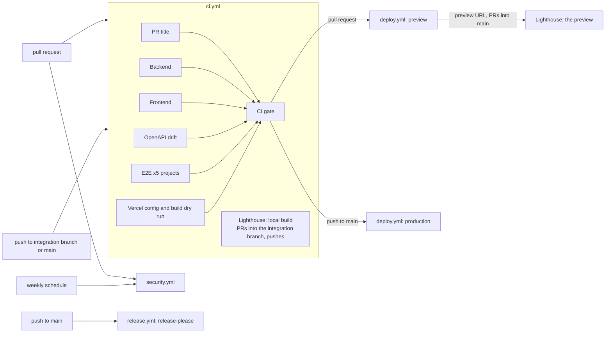

# CI/CD

Five workflows, one deploy path. Every action is pinned to a full commit SHA (Dependabot keeps them
current), every job declares its own least-privilege `permissions:` and a `timeout-minutes`.

## Workflow graph

| Workflow         | Runs on                                    | What it enforces                                                                                                                                                                                                  |
| ---------------- | ------------------------------------------ | ----------------------------------------------------------------------------------------------------------------------------------------------------------------------------------------------------------------- |
| `ci.yml`         | PR, push (integration branch, main), manual | PR title, backend (ruff, format, mypy strict, pytest 100 % branch on `postgres:17`), frontend (eslint, prettier, `tokens:check`, tsc, vitest 100 %, build), OpenAPI drift, E2E per Playwright project, `vercel.json` + build dry run |
| `security.yml`   | PR, push, weekly, manual                   | CodeQL (python, javascript-typescript), gitleaks on the full history, dependency review (PR), pip-audit + pnpm audit (high), bandit, OSV-Scanner                                                                 |
| `lighthouse.yml` | called by `ci.yml` (PRs, pushes); manual | `lighthouserc.json` budgets (mobile performance >= 90, accessibility / best practices / SEO = 100, LCP < 2.5 s, CLS < 0.05, TBT < 200 ms on `/` and `/methodology`): **blocking** on `main`, **published but not blocking** on the integration branch until `LIGHTHOUSE_ENFORCE` is switched on, see [Lighthouse](#lighthouse-staged-gate-and-measurement-fidelity) |
| `deploy.yml`     | called by `ci.yml` after the gate; manual  | `vercel pull` > `vercel build` > migrations (production) > `vercel deploy --prebuilt` > smoke > promote (production)                                                                                              |
| `release.yml`    | push to `main`, manual                     | release-please: Conventional Commits > release PR (CHANGELOG, versions) > tag + GitHub Release                                                                                                                    |

Deployments are gated with `needs: [gate]` inside `ci.yml` (not `workflow_run`), so they run on the
very commit CI tested, work from the integration branch, and never run for fork pull requests.
`workflow_dispatch` on `deploy.yml` (input `environment`: preview or production) is offered by GitHub
once the file exists on the default branch.

## Required secrets

Set under Settings > Secrets and variables > Actions. The pipeline never sets them.

| Secret                            | Used by                          | Notes                                                                                                                   |
| --------------------------------- | -------------------------------- | ----------------------------------------------------------------------------------------------------------------------- |
| `VERCEL_TOKEN`                    | deploy                           | A Vercel access token of the account that owns the project                                                              |
| `VERCEL_ORG_ID`, `VERCEL_PROJECT_ID` | deploy                        | From `.vercel/project.json` after `vercel link`                                                                         |
| `DATABASE_URL_OWNER`              | deploy (production bootstrap and migrations) | Administrator DSN (the Supabase `postgres` user) through the **session** pooler (port 5432, `sslmode=require`)          |
| `HAULCAST_OWNER_DB_PASSWORD`      | deploy (production bootstrap and migrations) | Password of the schema-owner role `haulcast_owner` (DDL): the bootstrap creates the role with it, the migrations run as it |
| `HAULCAST_APP_DB_PASSWORD`        | deploy (production bootstrap)    | Password of the least-privilege runtime role `haulcast_app`                                                             |
| `VERCEL_AUTOMATION_BYPASS_SECRET` | deploy smoke tests, Lighthouse  | Vercel Protection Bypass for Automation; previews stay protected, requests send `x-vercel-protection-bypass` (Lighthouse exchanges it for a cookie) |
| `RELEASE_PLEASE_TOKEN` (optional) | release                          | A PAT or app token. Without it release-please uses `GITHUB_TOKEN` and its release PR gets no CI run (GitHub limitation) |

Without the Vercel secrets a **preview** deployment is skipped with a visible warning annotation; a
**production** deployment fails loudly.

## Repository variables

Set under Settings > Secrets and variables > Actions > **Variables**. Not secrets, so they appear in
logs.

| Variable             | Used by          | Notes                                                                                                                                                                              |
| -------------------- | ---------------- | ---------------------------------------------------------------------------------------------------------------------------------------------------------------------------------- |
| `LIGHTHOUSE_ENFORCE` | `lighthouse.yml` | `true` makes a missed Lighthouse budget fail the job on every branch; unset or `false` keeps the staging below (published, not blocking, off `main`). Any other value fails the job. |

Flip it with `gh variable set LIGHTHOUSE_ENFORCE --body true` once the real pages meet the budgets.

## Lighthouse: staged gate and measurement fidelity

`lighthouserc.json` holds the budgets (the N1 requirements). `scripts/lighthouse_report.py` reads the
same file, evaluates them on the run `lhci` itself would assert on (`median-run`: closest to the median
first-contentful-paint and interactive time) and decides what a miss means:

| Event                                                            | Mode        | A missed budget                                                                  |
| ---------------------------------------------------------------- | ----------- | -------------------------------------------------------------------------------- |
| pull request into `main`, push to `main`                         | **enforce** | fails the job (`Lighthouse / Lighthouse budgets` is a required check on `main`)  |
| pull request into the integration branch, push to it, manual run | **report**  | published as a warning annotation, the job summary and one sticky PR comment     |
| any of the above with `LIGHTHOUSE_ENFORCE=true`                  | **enforce** | fails the job                                                                    |

The staging exists because the placeholder pages cannot meet the budgets yet; the integration card
that lands the real pages flips `LIGHTHOUSE_ENFORCE`. The sticky comment (marker
`<!-- lighthouse-report -->`, owned by `github-actions[bot]`, updated in place) is skipped for fork
pull requests, whose token is read-only; the full reports are the `lighthouse-reports` artifact.

**What is measured.** A gate that measures a different server than production is not a gate, so:

- By default the job builds the site exactly as a deployment is built (`scripts/vercel-build.sh
dry-run`, the same step the `vercel` CI job runs) and serves `.vercel/output` with
  `scripts/serve-vercel-output.mjs`. It evaluates the build's `config.json` routes on every request
  (all `vercel.json` headers including the CSP with the hashed inline scripts, the immutable cache for
  `/assets/*`, the SPA fallback, 404 pages) and answers text with brotli or gzip like Vercel's edge
  does. Load-time effects of the old compression-less preview server are gone.
- It is a local approximation and says so: HTTP/1.1 on loopback (no HTTP/2, no CDN latency), compression
  levels are assumptions, and `/api/*` answers `501` (the Python function is not served), so a page that
  calls the API on load needs the preview measurement. The server refuses `config.json` route features
  it does not implement instead of serving something different.
- For pull requests into `main`, once `deploy.yml` produces a preview, that **deployment** is
  measured instead (`lighthouse-preview` in `ci.yml`). A protected preview answers 401, so
  `scripts/lighthouse-bypass.cjs` sends `VERCEL_AUTOMATION_BYPASS_SECRET` once, in a tab the
  measurement does not use, and keeps the bypass **cookie**. Lighthouse's `extraHeaders` would send the
  secret to every request, third parties included, and write it into the saved reports; the job also
  scans the reports for the secret before uploading them. Run it by hand against any deployment with
  `gh workflow run lighthouse.yml -f url=https://<deployment>` (needs the workflow on the default branch).
- Chrome always runs headless: `lighthouserc.json` asks for `--headless=new` and the puppeteer launch is headless, so a
  local run never opens a window. Only the CI step adds `--no-sandbox` (the runner's AppArmor profile needs it).

## What `vercel.json` does (JSON has no comments)

- `framework: null`, `buildCommand`/`installCommand` for the prerendered React Router build and
  `outputDirectory: frontend/build/client`; `git.deploymentEnabled: false` (GitHub Actions deploys).
- One Python function, `api/index.py` (region `iad1`, `maxDuration` 30 s: the plan request budget is
  25 s). `excludeFiles` keeps `frontend/`, `node_modules/`, tests and tooling out of the bundle;
  dependencies come from `api/requirements.txt` (`uv export` of `backend/uv.lock`, drift-checked).
- Rewrites: `/api/(.*)` to the function, then a SPA fallback to `/__spa-fallback.html` for paths
  without a dot outside `/api/` and `/assets/`. Vercel serves existing files (prerendered pages,
  assets) before rewrites, and a missing hashed asset is a 404, not HTML.
- Headers: HSTS (`max-age` 2 years, `includeSubDomains`, `preload`), `nosniff`, `Referrer-Policy`,
  `Permissions-Policy`, COOP/CORP `same-origin`, `X-Frame-Options`, immutable cache for
  `/assets/*`, revalidating cache for everything else, and the CSP below for non-API paths.
- `X-Robots-Tag: noindex, nofollow` on `/design` and everything below it (D-27). The kitchen sink is
  public, as the living style guide, but not for search: the page also carries the `robots` meta tag
  and is not in the sitemap.
- Cron: `GET /api/v1/internal/maintenance` once a day (Hobby limit); Vercel Cron only issues GET, so
  the endpoint accepts GET (Bearer `CRON_SECRET`) and POST for manual runs.

### Content-Security-Policy and the inline scripts

React Router's prerendered HTML contains inline scripts (hydration context, route-module imports with
content-hashed asset names, React's streaming runtime). A strict `script-src 'self'` blocks them and
the page never hydrates, yet their hashes change with every build, so a committed hash would rot.
`scripts/vercel_output.py inject-csp` therefore runs after `vercel build`: it hashes every executable
inline script in the built HTML and appends the hashes to `script-src` in `.vercel/output/config.json`.
Styles follow the same rule (D-25). The committed policy is `style-src 'self'` plus
`style-src-attr 'unsafe-inline'`: stylesheets come from this origin, an inline `<style>` element is
blocked unless its hash is in `style-src`, and `inject-csp` adds the hash of every inline `<style>`
element it finds (there is none today). Style *attributes* stay allowed on purpose: React and React
Aria write them (the position of a slider thumb or a popover), a hash cannot allow an attribute, and
an attribute cannot carry a selector that leaks data the way a `<style>` element can.
`verify` then proves that every inline script is allowed by `script-src` and every inline `<style>`
by `style-src` (or `style-src-elem`, when the policy has one), that `style-src` and `style-src-elem`
never allow `'unsafe-inline'`, that `script-src` never allows `'unsafe-inline'`, `'unsafe-eval'` or
`'strict-dynamic'`, that the Python bundle contains no frontend or test files and that the
static tree and cron registration are complete. CI runs the identical sequence without a Vercel
account (`scripts/vercel-build.sh dry-run`); the deployed `@smoke` Playwright test asserts a clean
console, which is where a CSP violation would show. The no-flash theme script is covered
automatically, and no hash is ever committed.

`verify` reads text, so the same job also lets the browsers judge the result. `scripts/e2e-csp.sh`
serves `.vercel/output` with `scripts/serve-vercel-output.mjs` (the headers of production, hashes
included) and runs `frontend/e2e/csp.spec.ts` in Chromium, Firefox and WebKit: `/`, `/methodology`
and `/design` must load without a `securitypolicyviolation` event or a CSP console line and must
hydrate (the header's theme toggle answers a click). A negative control strips the hashes and
expects the page to be blocked, so a pass means the policy was enforced. The only change to the
served policy is that `upgrade-insecure-requests` is dropped in the test: WebKit applies it to
`http://127.0.0.1` and would send every asset request to a TLS port that nothing listens on.
Locally, after `bash scripts/vercel-build.sh dry-run`, run `bash scripts/e2e-csp.sh`; pass Playwright
arguments to narrow it (`--project=csp-webkit --workers=1`).

### Visual goldens (R1-18)

The four screenshots of `/design` (light and dark, 1280 and 390 px) are tagged `@golden` and run in the
`chromium` project only, on Linux, with `retries: 0`. Pixels depend on the platform's font rasteriser, so
one engine on one platform (the CI runner) owns the baselines, and a golden that needs a second try is a
flaky golden, not a passing one. CI compares against
`frontend/e2e/design-system.spec.ts-snapshots/*-linux.png` and fails on a difference. On any other
operating system the goldens are skipped, because a comparison there could only be a false alarm.

To make or refresh them after a change you intended, add the label `update-goldens` to the pull request
(or run Actions, Update visual goldens). `goldens.yml` runs the golden tests with
`--update-snapshots=all` on `ubuntu-24.04` and uploads the PNGs as the artifact `goldens-linux`. It
commits nothing: look at the pictures, then download them (`gh run download <run-id> -n goldens-linux`)
and commit them. The label does nothing for a pull request from a fork, because the job runs the pull
request's code.

### Bundle size: say the unit and the compressor (R1-39)

The first-load budget is **180 kB of gzip** for the JavaScript that `/` and `/methodology` load before
they hydrate: the module preloads, module scripts and inline-bootstrap imports in their prerendered
HTML. Always write the unit and the compressor: KiB is 1024 bytes, kB is 1000 bytes, and gzip level 6
and level 9 differ by about 1 KiB (a report once said "149.4 KB gzip": that was KiB at level 9, about
153 kB). At the R1-fix merge the 12 files are 457.40 KiB raw, 153.19 KiB gzip level 6
(156.9 kB) and 152.12 KiB gzip level 9 (155.8 kB). The code of `/design` is a chunk of its own and in
neither list; `e2e/design-system.spec.ts` ("is a chunk of its own") fails if the planner's first load
ever carries it.

## Setting up the Vercel project (what the first real deployment taught)

Verified facts from the tracer deployment, in the order they bite:

- **Create the project through the API, not `vercel link`.** For a new project `vercel link` scans
  the monorepo, detects `services` (frontend React Router, backend Django) and then refuses our
  `vercel.json`: top-level `functions`, `buildCommand`, `installCommand` and `outputDirectory`
  cannot coexist with `services`. Create the project with framework `null` (Other) and Node 22.x
  (`POST /v11/projects`, then `PATCH /v9/projects/<id>`), then run
  `vercel link --yes --project <name>`.
- **The first deployment of a project becomes production**, whatever the flags; every later one is
  a preview unless `--prod` is given. Make that first one a deliberate act.
- **`VERCEL_TOKEN` comes from the dashboard.** For a CLI login session Vercel answers
  `403 Cannot create tokens for this app` to both `POST /v3/user/tokens` and `vercel tokens create`.
- **The default domain is `<project>-<suffix>.vercel.app`** when the bare project name is taken
  (here `weather-aware-truck-routing-taupe.vercel.app`). Put the real production domains in
  `ALLOWED_HOSTS` and `VITE_SITE_URL`; preview hosts need no entry, see
  [Backend platform](BACKEND.md#runbook).
- **`vercel deploy --prebuilt` registers the cron** from `.vercel/output/config.json`; the
  deployment object lists it under `crons`.
- **Turn the preview toolbar off.** On a preview Vercel injects
  `https://vercel.live/_next-live/feedback/feedback.js` into every page for a normal browser (not for
  `HeadlessChrome`). The strict CSP blocks it, so the console shows a violation and the `@smoke`
  CSP test in `deploy.yml` fails on every preview. Set the project's `enablePreviewFeedback` to
  `false` (`PATCH /v9/projects/<id>`, or Project Settings > Vercel Toolbar); it applies to
  deployments created afterwards. The CSP stays strict instead of allowing `vercel.live`.

## Known limitations and follow-ups

- `workflow_dispatch` and `schedule` triggers only work from the default branch, so manual deploys are
  available once `deploy.yml` reaches `main`; previews run from pull requests meanwhile.
- The OpenAPI check enforces `shared/openapi.json` and that the generated types compile today; the
  committed-types comparison starts once `frontend/app/api/schema.d.ts` exists.
- `scripts/migrate-database.sh` bootstraps the roles with `scripts/bootstrap_db.py` (administrator
  connection) and then runs `manage.py migrate --database=owner` (the DDL role), see
  [Backend platform](BACKEND.md#role-model). Both steps were run end to end against a fresh
  PostgreSQL 17 and are safe to re-run; the first real production deployment still has to confirm
  the three repository secrets it needs.
- The preview-deployment measurement of Lighthouse (bypass cookie, `lhci` with `puppeteer-core`)
  cannot run before the Vercel secrets exist, and **no complete Lighthouse run through the bypass
  flow has been seen yet**. What is proven: `scripts/lighthouse-bypass.cjs` is unit tested, and
  against a local server that answers 401 unless it sees the bypass header or the `_vercel_jwt`
  cookie, a real Chrome driven by `lhci collect` authenticated the priming tab with the header
  (2 requests) and the 21 requests that followed carried the cookie alone, none unauthenticated.
  That is HTTP-level cookie authentication only. The Lighthouse run itself ended in
  `NO_NAVSTART` (the page-load trace was not recorded, so there are no scores) and no plain run
  without the bypass flow was completed as a control, so the cause is not established. The first
  real preview deployment is therefore the first full run of this path.
