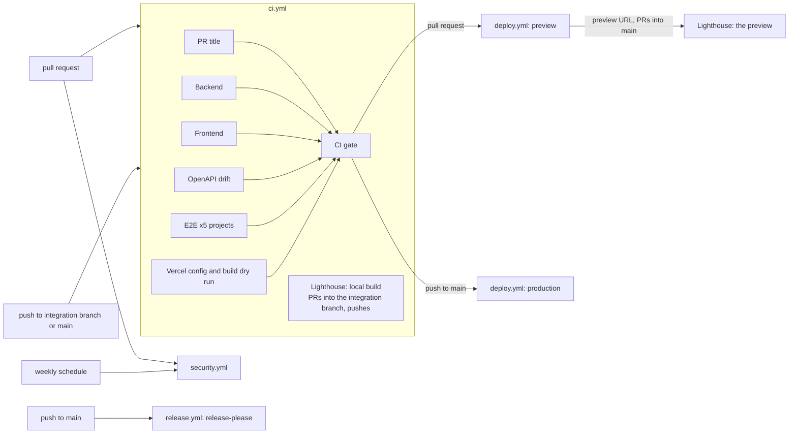

# CI/CD

Five workflows, one deploy path. Every action is pinned to a full commit SHA (Dependabot keeps them
current), every job declares its own least-privilege `permissions:` and a `timeout-minutes`.

## Workflow graph



| Workflow         | Runs on                                     | What it enforces                                                                                                                                                                                                                                                                                                                                                    |
| ---------------- | ------------------------------------------- | ------------------------------------------------------------------------------------------------------------------------------------------------------------------------------------------------------------------------------------------------------------------------------------------------------------------------------------------------------------------- |
| `ci.yml`         | PR, push (integration branch, main), manual | PR title, backend (ruff, format, mypy strict, pytest 100 % branch on `postgres:17`), frontend (eslint, prettier, `tokens:check`, tsc, vitest 100 %, build), OpenAPI drift, E2E per Playwright project, `vercel.json` + build dry run                                                                                                                                |
| `security.yml`   | PR, push, weekly, manual                    | CodeQL (python, javascript-typescript), gitleaks on the full history, dependency review (PR), pip-audit + pnpm audit (high), bandit, OSV-Scanner                                                                                                                                                                                                                    |
| `lighthouse.yml` | called by `ci.yml` (PRs, pushes); manual    | `lighthouserc.json` budgets (mobile performance >= 90, accessibility / best practices / SEO = 100, LCP < 2.5 s, CLS < 0.05, TBT < 200 ms on `/` and `/methodology`): **blocking** on `main`, **published but not blocking** on the integration branch until `LIGHTHOUSE_ENFORCE` is switched on, see [Lighthouse](#lighthouse-staged-gate-and-measurement-fidelity) |
| `deploy.yml`     | called by `ci.yml` after the gate; manual   | `vercel pull` > `vercel build` > migrations (production) > `vercel deploy --prebuilt` > smoke > promote (production)                                                                                                                                                                                                                                                |
| `release.yml`    | push to `main`, manual                      | release-please: Conventional Commits > release PR (CHANGELOG, versions) > tag + GitHub Release                                                                                                                                                                                                                                                                      |

Deployments are gated with `needs: [gate]` inside `ci.yml` (not `workflow_run`), so they run on the
very commit CI tested, work from the integration branch, and never run for fork pull requests.
`workflow_dispatch` on `deploy.yml` (input `environment`: preview or production) is offered by GitHub
once the file exists on the default branch.

## Required secrets

The pipeline never sets a secret. They live in four places, and the ones only production needs are
not readable from pull request workflows.

**GitHub repository secrets** (Settings > Secrets and variables > Actions). Every workflow run of
the repository can read them, runs for pull requests from branches of this repository included.

| Secret                               | Used by                         | Notes                                                                                                                                                                                                                 |
| ------------------------------------ | ------------------------------- | --------------------------------------------------------------------------------------------------------------------------------------------------------------------------------------------------------------------- |
| `VERCEL_TOKEN`                       | deploy (preview and production) | A Vercel token made in the dashboard, 90 days: [expiry and rotation](#vercel_token-expiry-and-rotation)                                                                                                               |
| `VERCEL_ORG_ID`, `VERCEL_PROJECT_ID` | deploy                          | Identifiers from `.vercel/project.json` after `vercel link`; not credentials                                                                                                                                          |
| `VERCEL_AUTOMATION_BYPASS_SECRET`    | deploy smoke tests, Lighthouse  | Vercel Protection Bypass for Automation; previews stay protected, requests send `x-vercel-protection-bypass` (Lighthouse exchanges it for a cookie); [see below](#the-bypass-secret-vercel-exposes-it-to-deployments) |
| `RELEASE_PLEASE_TOKEN` (optional)    | release                         | A PAT or app token. Without it release-please uses `GITHUB_TOKEN` and its release PR gets no CI run (GitHub limitation)                                                                                               |

**GitHub `production` environment secrets** (Settings > Environments > production). Only a job that
declares `environment: production` can read them, and the environment accepts deployments from
`main` only ([details](#the-production-environment)).

| Secret                       | Used by                                      | Notes                                                                                                                      |
| ---------------------------- | -------------------------------------------- | -------------------------------------------------------------------------------------------------------------------------- |
| `DATABASE_URL_OWNER`         | deploy (production bootstrap and migrations) | Administrator DSN (the Supabase `postgres` user) through the **session** pooler (port 5432, `sslmode=require`)             |
| `HAULCAST_OWNER_DB_PASSWORD` | deploy (production bootstrap and migrations) | Password of the schema-owner role `haulcast_owner` (DDL): the bootstrap creates the role with it, the migrations run as it |
| `HAULCAST_APP_DB_PASSWORD`   | deploy (production bootstrap)                | Password of the least-privilege runtime role `haulcast_app`                                                                |

**Vercel environment variables** (Project > Settings > Environment Variables). The runtime reads
them; a change applies to deployments created afterwards.

| Variable                                              | Production                     | Preview                           | Notes                                                                                                                               |
| ----------------------------------------------------- | ------------------------------ | --------------------------------- | ----------------------------------------------------------------------------------------------------------------------------------- |
| `DJANGO_SECRET_KEY`, `RATE_LIMIT_SALT`, `CRON_SECRET` | its own value, sensitive       | its own value, sensitive          | Different values per environment; production's were generated in memory and are never written to disk, so nobody can read them back |
| `HAULCAST_APP_DB_PASSWORD`                            | shared with preview, sensitive | shared with production, sensitive | [One database](#one-database-for-preview-and-production)                                                                            |
| `DATABASE_URL_POOLED`, `TRUCK_TOP_SPEED_KPH`          | shared                         | shared                            | Configuration, not secret (the pooled URL carries no password)                                                                      |
| `ALLOWED_HOSTS`, `VITE_SITE_URL`                      | shared                         | shared                            | The production domains, see [Production domain](#production-domain)                                                                 |

The owner DSN and the owner password are **never** Vercel variables: the runtime does not need
them. Locally, `.env.local` (gitignored) holds the preview values of the three application secrets
and the database secrets, and deliberately not the production-only application secrets.

Without the Vercel secrets a **preview** deployment is skipped with a visible warning annotation; a
**production** deployment fails loudly (before it touches anything).

## The `production` environment

`production` is a GitHub environment that accepts deployments from the branch `main` only and has
**no required reviewers and no wait timer**: merging the final pull request into `main` is the
approval (D-30). `ci.yml` runs `deploy-production` on that push: a `--prod` build, the database
bootstrap and migrations before anything is promoted, a staged deployment (`--skip-domain`), the
smoke tests, then `vercel promote`.

`deploy.yml` declares `environment: ${{ inputs.environment }}` on its job, so the production call
runs in `production` and reads that environment's secrets, and a preview call runs in `preview`,
which has none. Only the guard step (it requires them for production alone) and the production-only
migration step reference the three database secrets. A preview job resolves them to empty strings
and never needs them. They used to be repository secrets, readable by any workflow run of the
repository.

Created once with the GitHub API (names only; `gh secret set` reads the value from stdin or
the prompt, never from the command line):

```bash
repo=ar27111994/weather-aware-truck-routing
gh api --method PUT "repos/$repo/environments/production" --input - <<'JSON'
{"wait_timer": 0, "reviewers": [], "deployment_branch_policy": {"protected_branches": false, "custom_branch_policies": true}}
JSON
gh api --method POST "repos/$repo/environments/production/deployment-branch-policies" --input - <<'JSON'
{"name": "main", "type": "branch"}
JSON
gh secret set DATABASE_URL_OWNER --env production --repo "$repo"   # likewise the two passwords
```

## One database for preview and production

One Supabase project serves both (D-33). The data is not personal: there are no accounts, only
cached forecasts, plans and rate-limit buckets, and previews sit behind Vercel Authentication. So
preview and production deliberately share the runtime role `haulcast_app`, its password
(`HAULCAST_APP_DB_PASSWORD`) and the pooled connection coordinates. This is an accepted trade-off:
a preview deployment can read and write the same cache, plan and rate-limit tables as production.
The role cannot run DDL, and the owner credentials are never on Vercel.

What stays separate is each environment's application secrets. In particular a different
`RATE_LIMIT_SALT` gives preview traffic different rate-limit buckets than production's.

## Production domain

The live URL is **`https://haulcast-routing.vercel.app`**. `haulcast.vercel.app` is taken: adding it
answers `409 Cannot add haulcast.vercel.app since it's already assigned to another project`. The
domain was added to the Vercel project; the earlier `weather-aware-truck-routing-taupe.vercel.app`
and `weather-aware-truck-routing-ar27111994s-projects.vercel.app` stay. `ALLOWED_HOSTS` lists all
three and `VITE_SITE_URL` (canonical and Open Graph URLs) is the new URL, for Production and Preview.

The variables apply to new deployments only. Until the first production deployment (the merge of
the final pull request, D-30) every production domain serves the placeholder first deployment: the
static pages work, `/api/*` answers 400.

## VERCEL_TOKEN: expiry and rotation

`VERCEL_TOKEN` is a token the maintainer made in the dashboard on 2026-10-20: a 90-day lifetime,
named `weather-aware-truck-routing-ci`. **It expires on 2027-01-18** (the dashboard shows the exact
time; `vercel tokens ls` lists names only). Rotate it by 2027-01-11. An expired token fails the
deploy job at `vercel pull`, before any migration, preview and production alike.

1. Dashboard > Account > Tokens > Create Token: name it `weather-aware-truck-routing-ci-<yyyy-mm>`,
   scope `ar27111994s-projects`, expiration 90 days. Only the dashboard can do this: for a CLI login
   session Vercel answers `403 Cannot create tokens for this app`.
2. In any terminal run `gh secret set VERCEL_TOKEN --repo ar27111994/weather-aware-truck-routing`
   and paste the value at the prompt. Never put it on a command line or in chat.
3. Prove it: the next pull request deploys a preview (the guard step reports the deployment as
   enabled and `vercel pull` passes), or re-run the deploy job of the latest one.
4. Delete the old token on the same dashboard page.

The token is a repository secret because preview deployments need it, so a workflow run from a
branch of this repository can read it. Vercel tokens are scoped to a team, not to an environment, so
a second token for the `production` environment would not narrow what it can do.

## The bypass secret: Vercel exposes it to deployments

`VERCEL_AUTOMATION_BYPASS_SECRET` is a GitHub secret (the smoke tests and Lighthouse send it) and,
on Vercel's side, a system environment variable that every deployment carries. Switching that
exposure off is not possible: `PATCH /v1/projects/<id>/protection-bypass` with `update.isEnvVar`
set to `false` is refused with `400 One bypass must be the VERCEL_AUTOMATION_BYPASS_SECRET
Environment Variable set on deployments`. Vercel's
[documentation](https://vercel.com/docs/deployment-protection/methods-to-bypass-deployment-protection/protection-bypass-automation)
says the same: one secret is always set as the variable, and every secret bypasses protection on
every deployment of the project. Pointing the variable at a second, unused secret would only move
the exposure, so we did not.

What holds instead: nothing in the deployed code (`backend/src`, `api/`, `frontend/app`) reads or
logs the variable (only CI scripts read it, from the GitHub secret). A leak would let someone open
this project's protected previews, which serve non-personal data (D-33); the production domains are
public anyway. To rotate, regenerate the secret under Project > Settings > Deployment Protection >
Protection Bypass for Automation, then run `gh secret set VERCEL_AUTOMATION_BYPASS_SECRET`, update
`.env.local` and redeploy: Vercel sets the value when it builds a deployment, so earlier
deployments keep the old one.

## Rotation

- **`VERCEL_TOKEN`:** see above.
- **Production application secrets** (`DJANGO_SECRET_KEY`, `RATE_LIMIT_SALT`, `CRON_SECRET`):
  generate the value in memory and pipe it to the CLI, for example
  `python -c "import secrets,sys; sys.stdout.write(secrets.token_urlsafe(64))" | vercel env add DJANGO_SECRET_KEY --environment production --sensitive --force --yes --project weather-aware-truck-routing --scope ar27111994s-projects`
  (`token_urlsafe(32)` for the other two). The next production deployment picks them up. Nothing
  visible changes for `DJANGO_SECRET_KEY` (no sessions, no cookies); a new `RATE_LIMIT_SALT` starts
  every client with fresh buckets; for `CRON_SECRET` Vercel sends the new value with the first cron
  run after that deployment.
  Vercel Cron sends `Authorization: Bearer <CRON_SECRET>` to the path in `vercel.json` ("The value
  of the variable will be automatically sent as an `Authorization` header when Vercel invokes your
  cron job", [Vercel](https://vercel.com/docs/cron-jobs/manage-cron-jobs#securing-cron-jobs)) and
  the maintenance endpoint compares exactly that header with `CRON_SECRET`. The production value is
  write-only, so nobody can call the endpoint with it by hand: after a scheduled run, read the cron
  job's logs (Project > Settings > Cron Jobs > View Logs).
- **Database passwords (a short, planned downtime).** Postgres keeps one password per role, so no
  moment exists at which an old and a new deployment can both authenticate; a no-downtime rotation
  would need a second runtime role, which the bootstrap does not create. The bootstrap re-applies
  the role passwords on every run. Pick a quiet moment, then:
  1. Put the new values in the `production` environment (`gh secret set ... --env production`) and
     in `.env.local`, and the new app password in both Vercel targets. Nothing changes live yet:
     deployments keep the variables they were built with.
  2. Run a production deployment (a push to `main`). Its migration step sets the new passwords, so
     from then on the live deployment answers 503 `database_unavailable`. The staged deployment
     carries the new password, passes the smoke tests and is promoted, which ends the window a few
     minutes later.
  3. Preview deployments built earlier keep the old password and fail until their pull request is
     deployed again (preview and production share `haulcast_app`, D-33).
- **`VERCEL_AUTOMATION_BYPASS_SECRET`:** see above.

## Repository variables

Set under Settings > Secrets and variables > Actions > **Variables**. Not secrets, so they appear in
logs.

| Variable             | Used by          | Notes                                                                                                                                                                                |
| -------------------- | ---------------- | ------------------------------------------------------------------------------------------------------------------------------------------------------------------------------------ |
| `LIGHTHOUSE_ENFORCE` | `lighthouse.yml` | `true` makes a missed Lighthouse budget fail the job on every branch; unset or `false` keeps the staging below (published, not blocking, off `main`). Any other value fails the job. |

Flip it with `gh variable set LIGHTHOUSE_ENFORCE --body true` once the real pages meet the budgets.

## Lighthouse: staged gate and measurement fidelity

`lighthouserc.json` holds the budgets (the N1 requirements). `scripts/lighthouse_report.py` reads the
same file, evaluates them on the run `lhci` itself would assert on (`median-run`: closest to the median
first-contentful-paint and interactive time) and decides what a miss means:

| Event                                                            | Mode        | A missed budget                                                                 |
| ---------------------------------------------------------------- | ----------- | ------------------------------------------------------------------------------- |
| pull request into `main`, push to `main`                         | **enforce** | fails the job (`Lighthouse / Lighthouse budgets` is a required check on `main`) |
| pull request into the integration branch, push to it, manual run | **report**  | published as a warning annotation, the job summary and one sticky PR comment    |
| any of the above with `LIGHTHOUSE_ENFORCE=true`                  | **enforce** | fails the job                                                                   |

The staging exists because the placeholder pages cannot meet the budgets yet; the integration card
that lands the real pages flips `LIGHTHOUSE_ENFORCE`. The sticky comment (marker
`<!-- lighthouse-report -->`, owned by `github-actions[bot]`, updated in place) is skipped for fork
pull requests, whose token is read-only; the full reports are the `lighthouse-reports` artifact.

**What is measured.** A gate that measures a different server than production is not a gate, so:

- By default the job builds the site exactly as a deployment is built (`scripts/vercel-build.sh
dry-run`, the same step the `vercel` CI job runs) and serves `.vercel/output` with
  `scripts/serve-vercel-output.mjs`. It evaluates the build's `config.json` routes on every request
  (all `vercel.json` headers including the CSP with the hashed inline scripts, the immutable cache for
  `/assets/*`, the SPA fallback, 404 pages) and answers text with brotli or gzip like Vercel's edge
  does. Load-time effects of the old compression-less preview server are gone.
- It is a local approximation and says so: HTTP/1.1 on loopback (no HTTP/2, no CDN latency), compression
  levels are assumptions, and `/api/*` answers `501` (the Python function is not served), so a page that
  calls the API on load needs the preview measurement. The server refuses `config.json` route features
  it does not implement instead of serving something different.
- For pull requests into `main`, once `deploy.yml` produces a preview, that **deployment** is
  measured instead (`lighthouse-preview` in `ci.yml`). A protected preview answers 401, so
  `scripts/lighthouse-bypass.cjs` sends `VERCEL_AUTOMATION_BYPASS_SECRET` once, in a tab the
  measurement does not use, and keeps the bypass **cookie**. Lighthouse's `extraHeaders` would send the
  secret to every request, third parties included, and write it into the saved reports; the job also
  scans the reports for the secret before uploading them. Run it by hand against any deployment with
  `gh workflow run lighthouse.yml -f url=https://<deployment>` (needs the workflow on the default branch).
- Chrome always runs headless: `lighthouserc.json` asks for `--headless=new` and the puppeteer launch is headless, so a
  local run never opens a window. Only the CI step adds `--no-sandbox` (the runner's AppArmor profile needs it).

## What `vercel.json` does (JSON has no comments)

- `framework: null`, `buildCommand`/`installCommand` for the prerendered React Router build and
  `outputDirectory: frontend/build/client`; `git.deploymentEnabled: false` (GitHub Actions deploys).
- One Python function, `api/index.py` (region `iad1`, `maxDuration` 30 s: the plan request budget is
  25 s). `excludeFiles` keeps `frontend/`, `node_modules/`, tests and tooling out of the bundle;
  dependencies come from `api/requirements.txt` (`uv export` of `backend/uv.lock`, drift-checked).
- Rewrites: `/api/(.*)` to the function, then a SPA fallback to `/__spa-fallback.html` for paths
  without a dot outside `/api/` and `/assets/`. Vercel serves existing files (prerendered pages,
  assets) before rewrites, and a missing hashed asset is a 404, not HTML.
- Headers: HSTS (`max-age` 2 years, `includeSubDomains`, `preload`), `nosniff`, `Referrer-Policy`,
  `Permissions-Policy`, COOP/CORP `same-origin`, `X-Frame-Options`, immutable cache for
  `/assets/*`, revalidating cache for everything else, and the CSP below for non-API paths.
- `X-Robots-Tag: noindex, nofollow` on `/design` and everything below it (D-27). The kitchen sink is
  public, as the living style guide, but not for search: the page also carries the `robots` meta tag
  and is not in the sitemap.
- Cron: `GET /api/v1/internal/maintenance` once a day (Hobby limit); Vercel Cron only issues GET, so
  the endpoint accepts GET (Bearer `CRON_SECRET`) and POST for manual runs.

### Content-Security-Policy and the inline scripts

React Router's prerendered HTML contains inline scripts (hydration context, route-module imports with
content-hashed asset names, React's streaming runtime). A strict `script-src 'self'` blocks them and
the page never hydrates, yet their hashes change with every build, so a committed hash would rot.
`scripts/vercel_output.py inject-csp` therefore runs after `vercel build`: it hashes every executable
inline script in the built HTML and appends the hashes to `script-src` in `.vercel/output/config.json`.
Styles follow the same rule (D-25). The committed policy is `style-src 'self'` plus
`style-src-attr 'unsafe-inline'`: stylesheets come from this origin, an inline `<style>` element is
blocked unless its hash is in `style-src`, and `inject-csp` adds the hash of every inline `<style>`
element it finds (there is none today). Style _attributes_ stay allowed on purpose: React and React
Aria write them (the position of a slider thumb or a popover), a hash cannot allow an attribute, and
an attribute cannot carry a selector that leaks data the way a `<style>` element can.
`verify` then proves that every inline script is allowed by `script-src` and every inline `<style>`
by `style-src` (or `style-src-elem`, when the policy has one), that `style-src` and `style-src-elem`
never allow `'unsafe-inline'`, that `script-src` never allows `'unsafe-inline'`, `'unsafe-eval'` or
`'strict-dynamic'`, that the Python bundle contains no frontend or test files and that the
static tree and cron registration are complete. CI runs the identical sequence without a Vercel
account (`scripts/vercel-build.sh dry-run`); the deployed `@smoke` Playwright test asserts a clean
console, which is where a CSP violation would show. The no-flash theme script is covered
automatically, and no hash is ever committed.

`verify` reads text, so the same job also lets the browsers judge the result. `scripts/e2e-csp.sh`
serves `.vercel/output` with `scripts/serve-vercel-output.mjs` (the headers of production, hashes
included) and runs `frontend/e2e/csp.spec.ts` in Chromium, Firefox and WebKit: `/`, `/methodology`,
`/design` and `/design/map` must load without a `securitypolicyviolation` event or a CSP console line
and must hydrate (the header's theme toggle answers a click). A violation is reported with the file,
line and column that caused it. A negative control strips the hashes and
expects the page to be blocked, so a pass means the policy was enforced. The only change to the
served policy is that `upgrade-insecure-requests` is dropped in the test: WebKit applies it to
`http://127.0.0.1` and would send every asset request to a TLS port that nothing listens on.
Locally, after `bash scripts/vercel-build.sh dry-run`, run `bash scripts/e2e-csp.sh`; pass Playwright
arguments to narrow it (`--project=csp-webkit --workers=1`).

The map (`/design/map`, and the planner once it shows a plan) is the one page that runs a web worker
and loads third-party data. MapLibre GL JS 6 is told to start its worker from a same-origin asset
(`setWorkerUrl` in `frontend/app/features/map`), so `worker-src` is exactly `'self'`, with no `blob:`
(`scripts/check_vercel_config.py` fails on anything else). The basemap's style, tiles, glyphs and
sprites all come from `https://tiles.openfreemap.org`, the only third-party host in `connect-src` and
`img-src`. `script-src` has no `'unsafe-eval'` and no `'wasm-unsafe-eval'`: nothing on these pages
compiles WebAssembly, and the one library that tried to compile JavaScript from a string, Zod (its
object parsers are generated with `new Function`), runs with `jitless` from `frontend/app/api/zod.ts`.
Without that, Zod probes `new Function("")` when the first schema is created; the policy blocks the
probe and the browser reports it (blocked `eval`) even though Zod catches the error. ESLint keeps every
runtime import of Zod on that module, and `frontend/app/api/zod.test.ts` fails if a schema is created
or parsed through the Function constructor.

### Visual goldens (R1-18)

Eight screenshots are tagged `@golden`: `/design` and the map harness `/design/map` (with a blank
basemap, so no third-party tile is in the picture), each in light and dark at 1280 and 390 px. They run
in the `chromium` project only, on Linux, with `retries: 0`. Pixels depend on the platform's font
rasteriser, so one engine on one platform (the CI runner) owns the baselines, and a golden that needs a
second try is a flaky golden, not a passing one. CI compares against
`frontend/e2e/<spec>.spec.ts-snapshots/*-linux.png` and fails on a difference. On any other
operating system the goldens are skipped, because a comparison there could only be a false alarm.

To make or refresh them after a change you intended, add the label `update-goldens` to the pull request
(or run Actions, Update visual goldens). `goldens.yml` runs the golden tests with
`--update-snapshots=all` on `ubuntu-24.04` and uploads the PNGs as the artifact `goldens-linux`. It
commits nothing: look at the pictures, then download them (`gh run download <run-id> -n goldens-linux`)
and commit them. The label does nothing for a pull request from a fork, because the job runs the pull
request's code.

### Firefox runs headed inside Xvfb, on CI only (D-40)

Firefox runs its graphics probe at every start, headless or not, and the probe needs an X11 or Wayland display. The GPU-less runner has none, so the probe fails and Firefox blocks WebGL 2, which MapLibre needs. CI therefore runs only the `firefox` matrix row and the `csp-firefox` project headed inside `xvfb-run --auto-servernum --server-args="-screen 0 1920x1080x24"`, where the probe finds a display and Mesa's llvmpipe renders WebGL 2 in software; every other project stays headless everywhere. The opt-in is `E2E_FIREFOX_XVFB=1`, and `playwright.config.ts` refuses it at load time, naming D-40, unless `CI` is set on Linux with a `DISPLAY`, so it can never open a window on a developer's machine. Every map test first asserts a WebGL 2 context and fails, naming the engine and D-40, rather than skipping.

### Map smoothness (R7)

`frontend/e2e/map.spec.ts` (tag `@perf`, `chromium` project only, `retries: 0`) waits until every
heatmap frame is ready on `/design/map`, then sweeps the timeline 0 to 48 to 0 hours by keyboard and
by pointer drag while it records long tasks (`PerformanceObserver`), the time between animation frames
and every network request. It fails on any request during a sweep, any long task over 50 ms, or a
median frame time over 18 ms (55 fps). CI keeps what it measured, pass or fail, as the artifact
`perf-r7` (`perf.json`). The budget is not loosened when it fails: the rendering technique changes.

### Bundle size: say the unit and the compressor (R1-39)

The first-load budget is **180 kB of gzip** for the JavaScript that `/` and `/methodology` load before
they hydrate: the module preloads, module scripts and inline-bootstrap imports in their prerendered
HTML. Always write the unit and the compressor: KiB is 1024 bytes, kB is 1000 bytes, and gzip level 6
and level 9 differ by about 1 KiB (a report once said "149.4 KB gzip": that was KiB at level 9, about
153 kB). At the R1-fix merge the 12 files are 457.40 KiB raw, 153.19 KiB gzip level 6
(156.9 kB) and 152.12 KiB gzip level 9 (155.8 kB). The code of `/design` is a chunk of its own and in
neither list; `e2e/design-system.spec.ts` ("is a chunk of its own") fails if the planner's first load
ever carries it.

## Setting up the Vercel project (what the first real deployment taught)

Verified facts from the tracer deployment, in the order they bite:

- **Create the project through the API, not `vercel link`.** For a new project `vercel link` scans
  the monorepo, detects `services` (frontend React Router, backend Django) and then refuses our
  `vercel.json`: top-level `functions`, `buildCommand`, `installCommand` and `outputDirectory`
  cannot coexist with `services`. Create the project with framework `null` (Other) and Node 22.x
  (`POST /v11/projects`, then `PATCH /v9/projects/<id>`), then run
  `vercel link --yes --project <name>`.
- **The first deployment of a project becomes production**, whatever the flags; every later one is
  a preview unless `--prod` is given. Make that first one a deliberate act.
- **`VERCEL_TOKEN` comes from the dashboard.** For a CLI login session Vercel answers
  `403 Cannot create tokens for this app` to both `POST /v3/user/tokens` and `vercel tokens create`.
  Expiry and rotation: [VERCEL_TOKEN](#vercel_token-expiry-and-rotation).
- **The default domain is `<project>-<suffix>.vercel.app`** when the bare project name is taken
  (here `weather-aware-truck-routing-taupe.vercel.app`). Put the real production domains in
  `ALLOWED_HOSTS` and `VITE_SITE_URL`; preview hosts need no entry, see
  [Backend platform](BACKEND.md#runbook). The memorable live domain is described under
  [Production domain](#production-domain).
- **`vercel deploy --prebuilt` registers the cron** from `.vercel/output/config.json`; the
  deployment object lists it under `crons`.
- **Turn the preview toolbar off.** On a preview Vercel injects
  `https://vercel.live/_next-live/feedback/feedback.js` into every page for a normal browser (not for
  `HeadlessChrome`). The strict CSP blocks it, so the console shows a violation and the `@smoke`
  CSP test in `deploy.yml` fails on every preview. Set the project's `enablePreviewFeedback` to
  `false` (`PATCH /v9/projects/<id>`, or Project Settings > Vercel Toolbar); it applies to
  deployments created afterwards. The CSP stays strict instead of allowing `vercel.live`.

## Known limitations and follow-ups

- `workflow_dispatch` and `schedule` triggers only work from the default branch, so manual deploys are
  available once `deploy.yml` reaches `main`; previews run from pull requests meanwhile.
- The OpenAPI check enforces `shared/openapi.json` and that the generated types compile today; the
  committed-types comparison starts once `frontend/app/api/schema.d.ts` exists.
- `scripts/migrate-database.sh` bootstraps the roles with `scripts/bootstrap_db.py` (administrator
  connection) and then runs `manage.py migrate --database=owner` (the DDL role), see
  [Backend platform](BACKEND.md#role-model). Both steps were run end to end against a fresh
  PostgreSQL 17 and are safe to re-run; the first real production deployment still has to confirm
  the three secrets of the `production` environment that it needs.
- The preview-deployment measurement of Lighthouse (bypass cookie, `lhci` with `puppeteer-core`)
  cannot run before the Vercel secrets exist, and **no complete Lighthouse run through the bypass
  flow has been seen yet**. What is proven: `scripts/lighthouse-bypass.cjs` is unit tested, and
  against a local server that answers 401 unless it sees the bypass header or the `_vercel_jwt`
  cookie, a real Chrome driven by `lhci collect` authenticated the priming tab with the header
  (2 requests) and the 21 requests that followed carried the cookie alone, none unauthenticated.
  That is HTTP-level cookie authentication only. The Lighthouse run itself ended in
  `NO_NAVSTART` (the page-load trace was not recorded, so there are no scores) and no plain run
  without the bypass flow was completed as a control, so the cause is not established. The first
  real preview deployment is therefore the first full run of this path.
